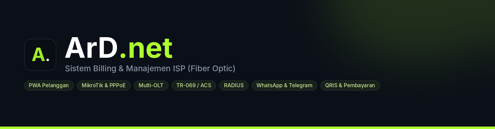

<p align="center">
  
</p>

<p align="center">
  <b>Sistem billing &amp; manajemen ISP / RT-RW Net — self-hosted, ringan, berbasis MikroTik.</b><br>
  PWA pelanggan · Panel admin · Portal teknisi &amp; kolektor · PPPoE · RADIUS · Isolir otomatis · OLT/ACS · WhatsApp/Telegram · QRIS
</p>

<p align="center">
  
  = 20">
  
  
</p>

---

## Daftar isi

1. [Fitur](#fitur)
2. [Persiapan: paket yang dibutuhkan](#persiapan-paket-yang-dibutuhkan)
3. [Instalasi](#instalasi) — Node + PM2 atau Docker
4. [Login pertama & pengaturan awal](#login-pertama--pengaturan-awal)
5. [Pengaturan MikroTik di sisi billing (1-klik)](#pengaturan-mikrotik-di-sisi-billing-1-klik)
6. [Alur kerja pelanggan & isolir](#alur-kerja-pelanggan--isolir)
7. [Update, backup & pindah mode](#update-backup--pindah-mode)
8. [Keamanan](#keamanan)
9. [Pengembang & lisensi](#pengembang--lisensi)

---

## Fitur

- **Panel admin** — pelanggan, paket, tagihan, pembayaran, laporan keuangan, tiket, multi-router.
- **Portal pelanggan (PWA)** — cek tagihan, bayar (QRIS), ganti WiFi, halaman isolir.
- **Portal teknisi & kolektor** — akses terbatas per peran.
- **MikroTik** — PPPoE secret via API **atau** RADIUS bawaan (PAP/CHAP), profil per paket, rate-limit.
- **Isolir otomatis & manual** — otomatis per tanggal jatuh tempo, manual per pelanggan, **isolir massal** (centang beberapa pelanggan); pelanggan terisolir dialihkan ke halaman tagihan.
- **Impor dari MikroTik** — ubah secret PPPoE yang sudah ada menjadi data pelanggan sekaligus.
- **Pendaftaran online** — pendaftar baru, kalkulator biaya, tombol *Setujui* yang membuat akun PPPoE otomatis (password acak).
- **OLT / ACS** — multi-OLT dan TR-069 (GenieACS).
- **Notifikasi** — WhatsApp (GOWA/Fonnte/Meta) dan bot Telegram untuk admin; asisten AI opsional.

---

## Persiapan: paket yang dibutuhkan

### Server billing

| Kebutuhan | Keterangan |
|---|---|
| OS | Armbian / Debian / Ubuntu (ARM64 atau x86-64) |
| RAM | minimal 1 GB (disarankan 2 GB) |
| Internet | dibutuhkan saat `npm ci` (paket `xlsx` diunduh dari `cdn.sheetjs.com`) |
| Port | `3001/tcp` (web), `8099/tcp` (redirector isolir), `1812/udp` + `1813/udp` (RADIUS) |

Paket sistem:

```bash
sudo apt update
sudo apt install -y git curl unzip sqlite3 build-essential python3
```

`build-essential` dan `python3` hanya terpakai bila modul native (`better-sqlite3`, `sharp`) harus dikompilasi karena tidak ada biner siap pakai untuk arsitektur server.

**Pilihan A — Node.js + PM2** (lebih mudah diedit):

```bash
# Node.js 22 (minimal 20)
curl -fsSL https://deb.nodesource.com/setup_22.x | sudo -E bash -
sudo apt install -y nodejs
sudo npm install -g pm2
node -v    # harus >= 20
```

**Pilihan B — Docker:**

```bash
curl -fsSL https://get.docker.com | sh
sudo usermod -aG docker $USER    # keluar-masuk SSH lagi setelah ini
docker --version && docker compose version
```

Jalankan **salah satu saja**. Node dan Docker memakai port yang sama.

### MikroTik

- RouterOS **6.43 atau lebih baru** (disarankan v7).
- Service API aktif (port `8728`) dan bisa dijangkau dari server billing.
- Satu user khusus untuk billing:

```routeros
/ip service set api disabled=no
/user group add name=billing policy=api,read,write,policy,test,sensitive
/user add name=billing group=billing password=GANTI_PASSWORD_INI
```

Policy `sensitive` dibutuhkan agar password secret PPPoE terbaca saat **Impor dari MikroTik**. Untuk keamanan, batasi akses API hanya dari IP server billing (`/ip service set api address=IP_SERVER/32`).

---

## Instalasi

### Pilihan A — Node.js + PM2

```bash
git clone <https://github.com/Andr-Drn/ard-net> ~/ard-net
cd ~/ard-net
npm ci --omit=dev
pm2 start ecosystem.config.js
pm2 save
pm2 startup          # jalankan baris sudo yang dicetak, lalu: pm2 save
```

Cek:

```bash
pm2 status
curl -s localhost:3001/health
```

> Jangan memakai `sudo npm ci` dan jangan membuat folder proyek sebagai `root`. Jika `npm ci` gagal dengan `EACCES`, jalankan `sudo chown -R $USER:$USER ~/ard-net`.

### Pilihan B — Docker

```bash
git clone <https://github.com/Andr-Drn/ard-net> ~/ard-net
cd ~/ard-net
mkdir -p docker-data/{config,database,logs,uploads,baileys,backups}
echo '{"server_port":3001,"cookie_secure":false}' > docker-data/config/settings.json
docker compose up -d --build
docker compose logs -f
```

`docker-compose.yml` sudah membuka `3001`, `8099` (isolir), dan `1812/1813 udp` (RADIUS). Data tersimpan di `docker-data/` (tidak ikut Git).

### Repo private

Gunakan *deploy key* (hanya baca) agar server bisa `git clone` dan `git pull`:

```bash
ssh-keygen -t ed25519 -f ~/.ssh/ardnet_deploy -N ""
cat ~/.ssh/ardnet_deploy.pub    # tambahkan di GitHub: Settings → Deploy keys (tanpa write)
GIT_SSH_COMMAND="ssh -i ~/.ssh/ardnet_deploy" git clone git@github.com:USERNAME/REPO.git ~/ard-net
```

---

## Login pertama & pengaturan awal

1. Buka `http://IP-SERVER:3001/admin/login` — login awal `admin` / `demo-isp123`. **Ganti password segera.**
2. Jika diakses lewat **HTTP** (bukan HTTPS), tambahkan di `settings.json` agar login tidak berputar kembali ke halaman login:

   ```json
   "cookie_secure": false,
   ```

   Lalu `pm2 restart ard-net` (Docker: `docker compose restart`). Kembalikan ke `true` bila sudah memakai HTTPS.
3. Ganti nilai rahasia bawaan: `session_secret`, `admin_api_key`, `webhook_secret`, `radius_secret` (bawaan `secret123`), dan password admin.
4. Di **Pengaturan**, isi nama perusahaan (`company_header`) dan **URL Halaman Isolir**, misalnya:

   ```
   http://192.168.10.185:3001/isolated
   ```

   Harus berupa IP/domain yang bisa dijangkau pelanggan dan MikroTik — bukan `localhost`.

`settings.json` dan `database/billing.db` dibuat otomatis saat pertama jalan.

---

## Pengaturan MikroTik di sisi billing (1-klik)

Semua yang biasanya diketik manual di MikroTik — IP pool, profil PPP, firewall filter, NAT, dan address-list isolir — dipasang lewat satu tombol dari billing.

### Langkah

1. **Daftarkan router** di billing: menu **Jaringan → MikroTik → Router** (`/admin/routers`) → tambah router (nama, IP, port API `8728`, user/password MikroTik di atas).
2. Isi **URL Halaman Isolir** di Pengaturan (lihat bagian sebelumnya).
3. Di halaman **Router**, klik **Script Isolir** → tab **1-Click Auto Setup (API)**.
4. Pilih router target, centang opsi yang dibutuhkan:
   - *Buat/lengkapi profil PPP untuk semua paket billing* (disarankan),
   - *Sambungkan RADIUS* (hanya jika memakai mode RADIUS),
   - *Timpa rentang pool yang sudah ada* (biasanya dikosongkan).
5. Klik **Jalankan Setup Jaringan & Isolir Sekarang (1-Klik)**. Hasil tiap langkah ditampilkan (✅ diterapkan, ➖ dilewati, ❌ gagal).

Setup bersifat **idempotent** — aman dijalankan berulang. Pool dan profil yang sudah ada **tidak ditimpa**; hanya kolom yang masih kosong yang dilengkapi.

#### Penjelasan tiga kotak centang

| Opsi | Yang dilakukan | Catatan |
|---|---|---|
| **Buat/lengkapi profil PPP untuk semua paket billing** (bawaan aktif) | Untuk tiap paket aktif dibuat profil PPP bernama paket, dengan `local-address` = gateway PPPoE, `remote-address` = pool PPPoE, dan `rate-limit` sesuai kecepatan paket. | Profil yang sudah ada tidak ditimpa: hanya `local-address` dan `remote-address` yang kosong diisi, `rate-limit` lama dibiarkan. Disarankan aktif bila *Kirim Mikrotik-Group* (`radius_send_group`) = 1, karena billing mengirim nama paket sebagai nama profil. |
| **Sambungkan RADIUS** | Menambah RADIUS client ke IP server billing (secret dari `radius_secret`, port 1812/1813, timeout 3 detik); bila sudah ada untuk IP yang sama, hanya secret disamakan. Menyetel `/ppp aaa` ke `use-radius=yes`, `accounting=yes`, `interim-update=1m`, dan mengubah autentikasi PPPoE server ber-MS-CHAP menjadi `pap,chap` (RADIUS billing tidak mendukung MS-CHAP). | Hanya untuk mode RADIUS. Perubahan autentikasi dapat memutus sesi; pelanggan perlu dial ulang. Kosongkan bila RADIUS di router sudah disetel. |
| **Timpa rentang pool yang sudah ada** | Bila rentang pool `radius_framed_pool` / `radius_isolir_pool` di router berbeda dengan billing, rentangnya diganti sesuai billing. | Hanya memengaruhi dua pool itu; profil PPP dan sesi aktif tidak diubah. Centang hanya saat rentang di billing baru diubah. |

#### Apa yang mengikuti Pengaturan RADIUS billing

- **Mengikuti billing** setiap setup dijalankan: nama dan rentang pool PPPoE/isolir, gateway PPPoE, gateway isolir (IP awal pool isolir dikurangi 1), rate limit isolir, rentang pool isolir di address-list `LIST_ISOLIR` (comment `BILLING_ISOLIR_POOL`), IP server billing, dan port redirector.
- **Limit kecepatan isolir** dikirim billing lewat RADIUS (`radius_isolir_rate_limit`) dan mengalahkan `rate-limit` profil MikroTik; nilai di profil hanya cadangan bila sesi tidak lewat RADIUS. Limit pelanggan normal dikirim billing bila `radius_use_profile` = 0, dan diambil dari profil router bila = 1.
- **Tidak otomatis berubah** di router yang sudah punya: pool, profil, dan kolom yang sudah terisi (kecuali rentang pool bila opsi *Timpa* dicentang). Jika nama pool diganti di billing, ubah juga `remote-address` profil isolir di MikroTik.
- **Nama tetap**: profil isolir mengikuti kolom `isolir_profile` pelanggan (kosong = `isolir`), serta nama list `LIST_ISOLIR`, `BILLING`, dan comment rule.


### Yang dipasang

| Komponen | Nilai bawaan |
|---|---|
| **IP pool PPPoE** `pool-pppoe` | `172.16.0.2 – 172.16.15.254` (IP gateway dikeluarkan dari pool) |
| **Gateway / local-address PPPoE** | `172.16.10.1` → jaringan `172.16.0.0/20` (±4.000 IP) |
| **IP pool isolir** `isolir` | `10.10.99.2 – 10.10.99.254` (gateway `10.10.99.1`) |
| **Profil PPP** `default` | local `172.16.10.1`, remote `pool-pppoe` (hanya mengisi yang kosong) |
| **Profil PPP isolir** `isolir` | local `10.10.99.1`, remote pool isolir, rate-limit `512k/512k`, DNS = gateway isolir |
| **Profil PPP per paket** | nama = nama paket, rate-limit dari kecepatan paket |
| **Address-list** `BILLING` & `LIST_ISOLIR` | server billing; pelanggan terisolir ditambahkan otomatis lewat hook on-up/on-down profil isolir |
| **Firewall filter** | izinkan DNS dan akses ke server billing, blok selain itu untuk `LIST_ISOLIR` |
| **NAT** | HTTP (port 80) pelanggan terisolir dialihkan ke redirector billing (`8099`) → halaman `/isolated` |
| **RADIUS** (opsional) | client RADIUS ke server billing, `/ppp aaa use-radius=yes`, autentikasi PPPoE server `pap,chap` |

Semua nilai di atas bisa diubah di menu **RADIUS Server** (kunci `radius_ip_gateway`, `radius_ip_pool_start`, `radius_ip_pool_end`, `radius_framed_pool`, `radius_isolir_ip_pool_start`, `radius_isolir_ip_pool_end`, `radius_isolir_rate_limit`) **sebelum** menjalankan setup.

### Kapasitas IP

Pool PPPoE bawaan memuat sekitar **4.092 IP** yang bisa dipakai bersamaan (jaringan `172.16.0.0/20` dikurangi IP gateway). Pool isolir bawaan `/24` hanya memuat **253 IP** — jika banyak pelanggan terisolir bersamaan, perbesar rentangnya di menu RADIUS Server (misalnya `10.10.96.2 – 10.10.111.254`) sebelum menjalankan setup.

### Catatan penting

- **Hanya HTTP yang dialihkan.** Situs HTTPS pada pelanggan terisolir akan timeout; HP biasanya memunculkan notifikasi portal captive lewat pengecekan HTTP. Uji dengan `http://neverssl.com`.
- **Hook isolir berlaku saat sesi PPP tersambung.** Pelanggan yang sudah online perlu redial (billing memutus sesinya saat profil diubah).
- **RADIUS hanya mendukung PAP/CHAP, bukan MS-CHAP.** Opsi *Sambungkan RADIUS* mengatur PPPoE server ke `pap,chap` otomatis.
- Backup konfigurasi MikroTik sebelum setup pertama: `/system backup save name=sebelum-ardnet`.
- Detail skrip isolir manual: [`script-auto.md`](script-auto.md). Integrasi RADIUS: [`docs/RADIUS_MIKROTIK_INTEGRATION.md`](docs/RADIUS_MIKROTIK_INTEGRATION.md).

---

## Alur kerja pelanggan & isolir

1. **Buat paket** dengan nama **sama persis** dengan profil PPP di MikroTik (atau biarkan 1-klik membuat profil dari paket).
2. **Pelanggan yang sudah ada di MikroTik:** menu **Pelanggan → Impor dari MikroTik** → *Muat Secret* → centang → impor. Mulai dengan 3–5 baris. Nama diambil dari `comment` (atau username), password dari secret, profil dicocokkan ke paket. Impor hanya membaca router, tidak mengubah secret.
3. **Pelanggan baru:** pendaftaran online → admin klik **Setujui** (akun PPPoE dibuat dengan password acak) atau tambah manual.
4. **Tagihan:** menu **Tagihan → Generate** untuk periode berjalan. Tagihan hanya dibuat untuk pelanggan yang sudah punya paket.
5. **Isolir:** otomatis lewat cron harian (02:00) untuk pelanggan dengan tagihan belum dibayar setelah *Tgl Isolir*; manual lewat menu **Tagihan** (per tagihan) atau **Pelanggan** (centang → **Isolir Terpilih** / **Buka Isolir Terpilih**). Pembayaran (tandai lunas oleh admin, kolektor, atau pembayaran online) membuka isolir otomatis.

> **Peringatan saat migrasi pelanggan lama:** pelanggan hasil impor memakai *Auto Isolir ON* dengan tanggal 10. Jika tagihan dibuat setelah tanggal itu dan belum dibayar, cron akan mengisolir mereka. Matikan *Auto Isolir* untuk pelanggan impor selama masa uji, atau generate tagihan hanya untuk beberapa pelanggan dulu. Fitur hapus otomatis pelanggan menunggak (`auto_delete_overdue_enabled`) juga aktif secara bawaan — periksa di Pengaturan.

---

## Update, backup & pindah mode

**Update:**

```bash
cd ~/ard-net && git pull
# Node + PM2:
npm ci --omit=dev && pm2 restart ard-net
# Docker:
docker compose up -d --build
```

> Jangan memakai menu *Update GitHub* di dalam aplikasi: menu itu mengarah ke repositori pengembang asli dan bisa menimpa perubahan Anda. Update lewat `git pull` dari repo Anda sendiri.

**Backup** (lakukan rutin; aplikasi boleh tetap berjalan):

```bash
sqlite3 ~/ard-net/database/billing.db ".backup '$HOME/backup-billing-$(date +%F).db'"
cp ~/ard-net/settings.json ~/backup-settings-$(date +%F).json
```

**Pindah Node ↔ Docker:** data berada di tempat berbeda.

| | Node + PM2 | Docker |
|---|---|---|
| Pengaturan | `~/ard-net/settings.json` | `docker-data/config/settings.json` |
| Database | `~/ard-net/database/billing.db` | `docker-data/database/billing.db` |

Hentikan yang lama, salin kedua file (database dengan perintah `.backup` di atas), lalu jalankan yang baru.

---

## Keamanan

- **Jangan pernah meng-commit** `settings.json`, `database/`, `docker-data/`, `.env`, atau `auth_info_baileys/` (sudah ada di `.gitignore`). Cek dengan `git status` sebelum commit pertama.
- Data pelanggan (nama, telepon, alamat) adalah data pribadi. Batasi akses server dan repo.
- Isi `telegram_admin_id` hanya dengan ID admin; siapa pun yang terdaftar bisa mengisolir, melunasi tagihan, dan me-reboot ONU lewat bot.
- **Asisten AI** (opsional): saat API key diisi, pertanyaan dan ringkasan data pelanggan dikirim ke penyedia AI di luar server. Biarkan kosong bila tidak diperlukan.
- Batasi akses API MikroTik hanya dari IP server billing dan gunakan user khusus.
- Lihat [`SECURITY.md`](SECURITY.md).

---

## Pengembang & lisensi

ArD.net adalah turunan dari proyek open source berikut dan dirilis di bawah **lisensi ISC** (lihat [`LICENSE`](LICENSE)); pemberitahuan hak cipta pengembang asli tetap dipertahankan:

- **OPEN-ISP** oleh **oxpoe** — [repositori utama (Gitea)](https://gitea.oxpoe.xyz/oxpoe/open-isp) · [Wiki](https://gitea.oxpoe.xyz/oxpoe/open-isp/wiki) · [demo](https://demo-openisp.oxpoe.xyz)
- **billing-rtrw** oleh **Alijaya Net** — [github.com/alijayanet/billing-rtrw](https://github.com/alijayanet/billing-rtrw)

Dukungan sukarela untuk pengembang asli: [oxpoe.xyz](https://oxpoe.xyz).

Riwayat perubahan: [`CHANGELOG.md`](CHANGELOG.md).
